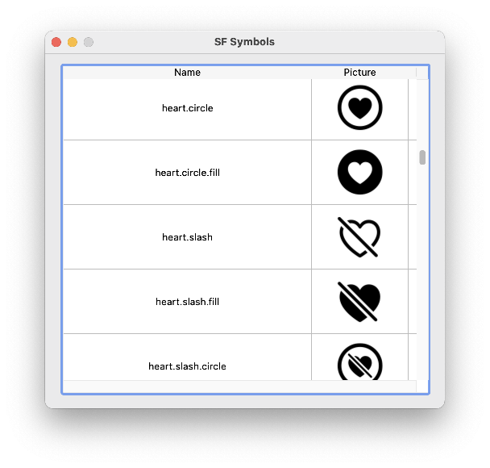

# SFSymbols

[](https://github.com/mesopelagique/SFSymbols/actions/workflows/build.yml)
[](https://github.com/mesopelagique/SFSymbols/actions/workflows/release.yml)
[](https://github.com/mesopelagique/SFSymbols/releases/latest)

⚠️ Only available on macOS Bigsur

Use on macOS [SF Symbols](https://developer.apple.com/sf-symbols/)
 


## How to use

```4d
$picture:=SFSymbolPicture("lasso.sparkles")
```

You could also set size

```4d
$picture:=SFSymbolPicture("lasso.sparkles"; {width: 64; height: 64})
```

## Options

The second parameter is an object accepting the following properties. Every option
is optional, and options that need a newer macOS are safely ignored on older systems
(the OS version is checked at runtime), so a database keeps working on macOS Big Sur.

### Size, weight & scale — macOS 11 (Big Sur)

| Option | Type | Description |
| --- | --- | --- |
| `width` | number | Output width in pixels (default `32`). |
| `height` | number | Output height in pixels (default keeps the aspect ratio). |
| `pointSize` | number | Point size of the symbol. Use together with `weight`. |
| `weight` | number | Font weight, see [NSFontWeight](https://developer.apple.com/documentation/appkit/nsfont/weight). |
| `scale` | number | Symbol scale: `1` small, `2` medium, `3` large, see [NSImageSymbolScale](https://developer.apple.com/documentation/appkit/nsimagesymbolscale?language=objc). |
| `style` | text | Text style, e.g. `"UICTFontTextStyleTitle2"`, see [NSFontTextStyle](https://developer.apple.com/documentation/appkit/nsfonttextstyle?language=objc). Can be combined with `scale`. |

### Rendering modes / colors — macOS 12 (Monterey) and later

Colors are passed as CSS-like hex strings: `"#RGB"`, `"#RGBA"`, `"#RRGGBB"` or `"#RRGGBBAA"` (the leading `#` is optional).

| Option | Type | Requires | Description |
| --- | --- | --- | --- |
| `color` | text (hex) | macOS 11+ | Tint color for a plain / `monochrome` symbol. See *Dark mode* below. |
| `window` | integer (window reference) | macOS 11+ | Match this window's appearance for the adaptive tint (e.g. `Current form window`). See *Dark mode* below. |
| `hierarchicalColor` | text (hex) | macOS 12+ | Hierarchical rendering: a single color, the symbol's layers get automatic opacity levels. |
| `paletteColors` | collection of text (hex) | macOS 12+ | Palette rendering: one color per layer. |
| `multicolor` | boolean | macOS 12+ | Multicolor rendering: use the symbol's own predefined colors. |
| `monochrome` | boolean | macOS 13+ | Monochrome rendering: every layer in a single color. |
| `variableValue` | number `0.0`–`1.0` | macOS 13+ | Fill level for symbols that support variable rendering (e.g. `wifi`, `speaker.wave.3`). |

```4d
// Hierarchical color (macOS 12+)
$picture:=SFSymbolPicture("square.stack.3d.up.fill"; {hierarchicalColor: "#0A84FF"})

// Palette colors, one per layer (macOS 12+)
$picture:=SFSymbolPicture("person.crop.circle.badge.plus"; {paletteColors: ["#FF375F"; "#30D158"]})

// Multicolor, the symbol's own colors (macOS 12+)
// Only symbols that ship a multicolor variant show colors (e.g. cloud.sun.rain.fill,
// thermometer.sun.fill, paintpalette.fill); others fall back to a single color.
$picture:=SFSymbolPicture("cloud.sun.rain.fill"; {multicolor: True})

// Monochrome (macOS 13+)
$picture:=SFSymbolPicture("heart.fill"; {monochrome: True})

// Variable value 0.0 - 1.0 (macOS 13+)
$picture:=SFSymbolPicture("wifi"; {variableValue: 0.4})

// Explicit tint color for a plain symbol
$picture:=SFSymbolPicture("gear"; {color: "#FF9500"})
```

Options can be combined, for example a hierarchical blue symbol at a larger scale:

```4d
$picture:=SFSymbolPicture("square.stack.3d.up.fill"; {width: 64; height: 64; scale: 3; hierarchicalColor: "#0A84FF"})
```

### Dark mode

The picture returned by `SFSymbolPicture` is a normal (baked) 4D picture, not a live
template image, so it does not repaint by itself when the user toggles Light / Dark.

For a plain or `monochrome` symbol:

- If you pass `color`, that tint is always used.
- Otherwise the symbol follows the current appearance **at the moment the picture is
  generated** — black in Light mode, white in Dark mode — so it stays visible either way.
  Regenerate the picture (e.g. on `On Load` / a form event) to reflect a later Light /
  Dark switch.
- By default the appearance is the whole application's. Pass `window` (a 4D window
  reference such as `Current form window`) to match that specific window instead — useful
  when a window uses a different appearance than the application.

```4d
// Match the current form window's Light / Dark appearance
$picture:=SFSymbolPicture("gear"; {window: Current form window})
```

The colored modes (`hierarchicalColor`, `paletteColors`, `multicolor`) carry their own
colors and are unaffected by the appearance.

## Get a list of available icons

Download the recommended app from [apple site](https://developer.apple.com/sf-symbols/) or you could look at the [demo app resources](https://github.com/mesopelagique/SFSymbols/blob/main/sample.4dbase/Resources/symbols.json) — the full list in Apple browse order, each symbol tagged with whether it has a real `multicolor` variant (regenerated by [`Tools/generate_symbols.swift`](https://github.com/mesopelagique/SFSymbols/blob/main/Tools/generate_symbols.swift)).

## Install

Compile the projet and put `SFSymbols.bundle` into your database or app [Plugins folder](sample.4dbase/Plugins/).

You could also download [the latest release](https://github.com/mesopelagique/SFSymbols/releases/latest/download/SFSymbols.bundle.zip) but it is maybe not well signed or compiled for apple M1
